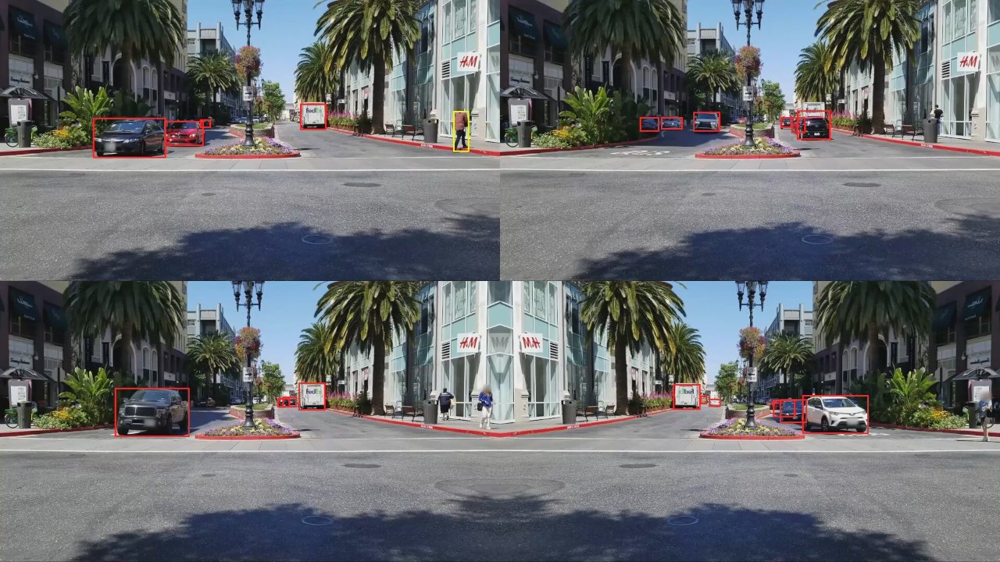
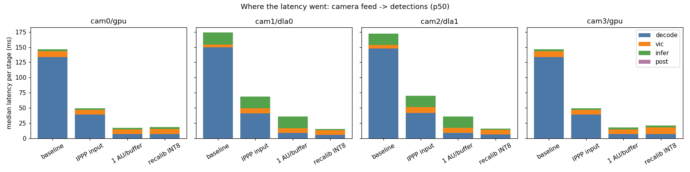
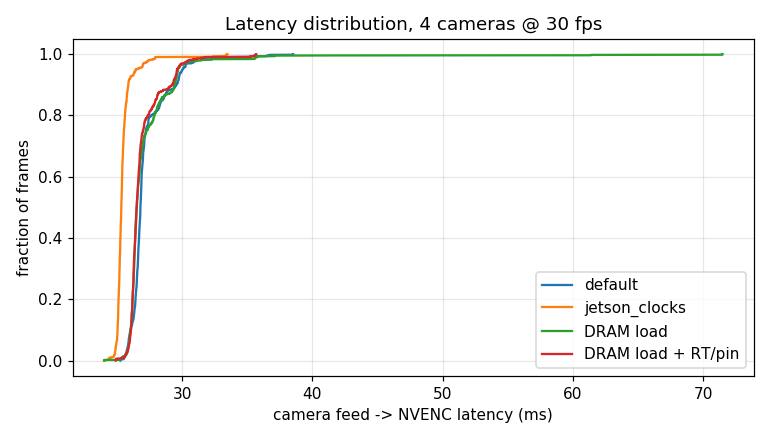

# orin-multicam

**A 4-camera automotive perception pipeline in C for Jetson AGX Orin that spreads
the work across Orin's dedicated hardware engines, keeps every pixel in shared
DRAM (zero copy), and measures per-frame worst-case latency.**

No peripherals needed: the four "cameras" are paced H.264 streams built from the
sample video that ships with JetPack, and the result is an annotated 2×2 mosaic
encoded by NVENC plus per-frame timing data.

```
            ┌──────── per camera (x4), 2 threads ─────────────────────────────────────┐
 H.264 AU   │ NVDEC        VIC                 CUDA        GPU | DLA0 | DLA1   CPU    │
 @30 fps ──►│ decode ──► NV12 1080p ──► RGBA 640x368 ──► RGB fp32 ──► ResNet10 ──► NMS │──┐
 (V4L2 M2M) │ (V4L2)     scale + CSC (+ mirror)      preprocess  TensorRT INT8         │  │
            │               └──► 960x540 tile ──────────────────────► CUDA box overlay │  │
            └─────────────────────────────────────────────────────────────────────────┘  │
                                                                                          ▼
                                   frame-synchronous compositor: VIC RGBA→NV12 ──► NVENC (V4L2) ──► mosaic.h264
```

| Stage | Engine | API used |
|---|---|---|
| H.264 decode ×4 | **NVDEC** | V4L2 M2M in plain C (`/dev/nvhost-nvdec` via libnvv4l2) |
| Scale, colour convert, mirror, mosaic tiles | **VIC** | `NvBufSurfTransform` |
| Pre-processing, box overlay | **GPU (CUDA)** | EGLImage-mapped `NvBufSurface`, no copies |
| Detection (ResNet10, INT8) | **GPU / DLA0 / DLA1** | TensorRT 8.5, per-camera placement |
| Box decode + NMS | **CPU** (Cortex-A78AE) | C |
| H.264 encode of the 2×2 mosaic | **NVENC** | V4L2 M2M in plain C (`/dev/nvhost-msenc`) |

Everything except the TensorRT wrapper (`src/trt_infer.cpp`, C++ API) and the
CUDA kernels is C11. All buffers are `NvBufSurface` dmabufs; the CPU never
touches pixel data.

## Results (Jetson AGX Orin 64GB, JetPack 5.1.2, `MODE_30W`)

See [`results/bench/summary.md`](results/bench/summary.md) for the full tables
and charts (regenerate with `scripts/bench.sh`).



**Optimisation journey.** 4 cameras at 30 fps; latency is measured from the camera
frame entering NVDEC until its detections are available. Values are the mean of the
4 cameras' p50, and the worst camera's p99:

| step | e2e p50 | e2e p99 | DLA infer | system power |
|---|---|---|---|---|
| 0. MMAPI sample stream (B-frames), byte-stream feed, sample calib table | 157.4 ms | 301.7 ms | 19.4 ms | 7.7 W |
| 1. camera-like IPPP input | 60.1 ms | 91.4 ms | 19.4 ms | 7.7 W |
| 2. one access unit per V4L2 buffer | 27.6 ms | 57.7 ms | 19.4 ms | 7.7 W |
| 3. INT8 recalibrated on the scene + sigmoid range fix | **18.1 ms** | **26.9 ms** | **1.9 ms** | **5.1 W** |



**Workload placement.** On the full pipeline (with mosaic and NVENC), all three placements
meet 4 × 30 fps at about 27 ms camera→encoder. Free-running, every placement tops out at
~480 frames/s, because the limit is the decode/VIC path, not inference. Moving cameras to
the DLAs is therefore about headroom: GPU utilisation drops from **59 % to 32 %** and
GPU+SOC power from **7.4 W to 6.1 W** at the same throughput.

**Determinism under load.** When every CPU core runs a memcpy storm (~51 GB/s of
DRAM traffic), median latency is unchanged, but the worst frame jumps to 71.5 ms.
SCHED_FIFO + per-camera core pinning brings it back to **35.7 ms** (p99 35.6 → 31.5 ms).
Locking clocks with `jetson_clocks` cuts GPU inference p50 from 2.6 ms to 1.6 ms,
because with default DVFS the GPU idles at 306 MHz for this bursty load.



**Accuracy check.** All cameras see identical frames (`--same-scene`). The DLA
engine gives the same number of detections as the GPU engine on 86.7 % of frames
(the sample calibration table: 78.0 %). Two GPU cameras agree on 100 %.

**Overlay check.** `tools/count_boxes.py` decodes every output mosaic and counts
frames that have no boxes: 0 of 450 in every benchmark run.

## Bring-up and debugging

Seven real problems were found and fixed along the way. Each one is written up in
[`docs/debug-log.md`](docs/debug-log.md) as symptom → hypothesis → evidence →
root cause → fix → measured result.

1. `v4l2_mmap()` returns `ENODEV` on libnvv4l2: export with `VIDIOC_EXPBUF` and `mmap()` the dmabuf instead.
2. A blocking `DQBUF` still returns `EAGAIN`: retry with a deadline instead of hanging.
3. 134 ms of decoder latency: the test stream had B-frames, so the decoder held frames for reordering. Re-encoded it as a camera-like IPPP stream.
4. One extra frame of latency: in byte-stream input mode the decoder waits for the next start code. Feeding one complete access unit per buffer cut decode from 40 ms to 6 ms.
5. DLA was 20× slower than GPU: the TensorRT 7 calibration table had missing scales, so DLA ran mixed INT8/FP16. Recalibrating on scene frames brought it from 26.7 ms to 1.0 ms.
6. The fast DLA engine then detected nothing: the entropy calibrator clipped the sigmoid output at 0.36. Fixing that range analytically brought GPU/DLA agreement to 86.7%.
7. About 35% of mosaic frames lost their boxes. A long-lived CUDA registration of an EGLImage does not make GPU writes visible to VIC. I tested three hypotheses, and per-access register/unregister fixed it (0%).

## Build & run

On the Jetson (JetPack 5.1.x, everything else comes from JetPack):

```bash
scripts/setup.sh                 # build, make camera-like input, calibrate, build engines
build/omc --output out.h264      # 4 cameras: GPU, DLA0, DLA1, GPU  @ 30 fps
scripts/bench.sh                 # full benchmark matrix -> results/bench/summary.md
```

Useful options (`build/omc --help`):

| option | meaning |
|---|---|
| `--engines gpu,dla0,dla1,gpu` | accelerator per camera |
| `--fps 30` / `--fps 0` | paced like a camera / free-running for capacity tests |
| `--output FILE.h264` | write the annotated 2×2 mosaic via NVENC |
| `--csv`, `--json` | per-frame stage timestamps / summary statistics |
| `--rt --pin` | SCHED_FIFO + mlockall + per-camera CPU pinning (root) |
| `--same-scene` | all cameras see identical frames (GPU vs DLA accuracy A/B) |
| `--chunked-input` | legacy byte-stream decoder input (shows the +1 frame latency) |

Convert the mosaic for playback on a laptop (raw H.264 has no timestamps, so
they are added while remuxing; no re-encode):

```bash
tools/h264_to_mp4.py out.h264 out.mp4 30
```

## Source map

| file | what |
|---|---|
| `src/v4l2_dec.c` | NVDEC via V4L2 M2M: formats, DMABUF capture plane, resolution-change event, EOS |
| `src/v4l2_enc.c` | NVENC via V4L2 M2M: DMABUF NV12 input, MMAP bitstream drained by a thread |
| `src/v4l2_util.h` | `EXPBUF`+`mmap`, `DQBUF` retry, extended controls |
| `src/h264_index.c` | Annex-B parser that splits the stream into access units |
| `src/cuda_map.c` | `NvBufSurface` → EGLImage → CUDA device pointer (registered once) |
| `src/kernels.cu` | RGBA→planar float preprocessing, box overlay |
| `src/trt_infer.cpp` | the only C++: TensorRT 8.5 engine/context behind a C API |
| `src/postprocess.c` | ResNet10 grid decode + NMS |
| `src/stats.c` | per-stage timestamps, p50/p99/max, CSV/JSON |
| `src/main.c` | threads, pacing, frame-synchronous mosaic, CLI |
| `tools/build_engine.cpp` | engine builder with real-data INT8 calibrator, GPU or DLA |
| `tools/fix_calib_cache.py` | override a tensor's INT8 range in a calibration cache |
| `tools/membw_hog.c` | DRAM bandwidth load generator for contention tests |
| `tools/count_boxes.py`, `tools/compare_acc.py` | output overlay check, GPU-vs-DLA detection agreement |
| `tools/h264_to_mp4.py` | timestamp + remux raw H.264 into MP4 |
| `scripts/` | setup, benchmark matrix, tegrastats parser, report/charts |

## What I would do next

* **Remove the GPU from the DLA path.** The Nsight Systems trace
  (`results/demo/omc_trace.nsys-rep`) shows TensorRT still runs an input reformat
  (cuTENSOR `permutationKernelPLC3`, ~29 µs per DLA frame, 9.7 % of GPU kernel time) on the GPU. Writing FP16 `DLA_LINEAR` input directly
  from the preprocessing kernel (`--inputIOFormats`) would make DLA cameras GPU-free.
* **Batch the two GPU cameras** into one `enqueue` (batch 2) to cut kernel-launch overhead.
* **A real camera source.** Swapping the file feeder for libargus/V4L2 CSI capture
  only changes the producer side, because the rest of the pipeline already works
  on `NvBufSurface` dmabufs.
* **Hardware sync instead of timestamps.** Use the NVDEC/VIC/NVENC fences
  (`NvBufSurfTransformAsync` + sync objects) so CPU threads stop blocking on
  every engine.
