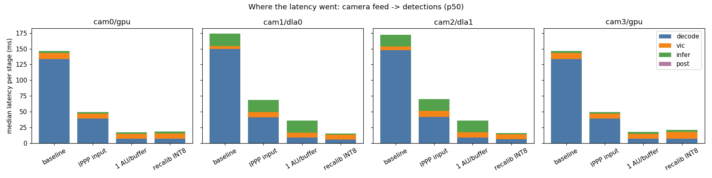
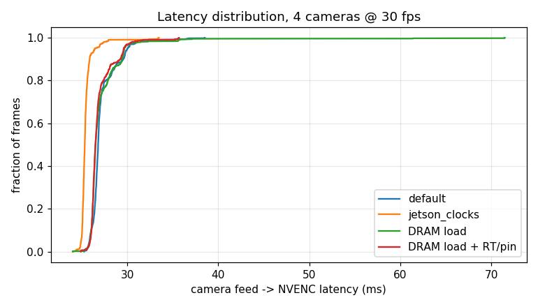

# Benchmark results

Jetson AGX Orin 64GB, JetPack 5.1.2 (L4T R35.4.1), nvpmodel MODE_30W, ResNet10 detector 640x368, 4 x 1080p H.264 inputs.

## Optimisation journey (4 cams, GPU/DLA0/DLA1/GPU, 30 fps, e2e = camera feed -> detections)

| run | total fps | infer p50 (ms) | e2e p50 (ms) | e2e p99 worst cam (ms) | e2e max (ms) | GPU util @ MHz | GPU+SOC / SYS5V (W) |
|---|---|---|---|---|---|---|---|
| 0. MMAPI sample bitstream (High profile, B-frames), byte-stream feed, TRT7 calib table | 121 | 10.93 | 157.4 | 301.7 | 321.5 | 41% @ 301 | 7.2 / 7.7 |
| 1. camera-like IPPP input (no B-frames) | 120 | 10.95 | 60.1 | 91.4 | 92.4 | 44% @ 306 | 7.2 / 7.7 |
| 2. one access unit per V4L2 buffer | 120 | 10.93 | 27.6 | 57.7 | 59.6 | 43% @ 305 | 7.2 / 7.7 |
| 3. INT8 recalibrated on scene + sigmoid range fix | 120 | 2.57 | 18.1 | 26.9 | 32.5 | 26% @ 308 | 5.7 / 5.1 |

## Workload placement (full pipeline incl. 2x2 mosaic + NVENC, e2e = camera feed -> encoder)

| run | total fps | infer p50 (ms) | e2e p50 (ms) | e2e p99 worst cam (ms) | e2e max (ms) | GPU util @ MHz | GPU+SOC / SYS5V (W) |
|---|---|---|---|---|---|---|---|
| all 4 cameras on GPU | 120 | 3.11 | 26.7 | 32.3 | 35.4 | 34% @ 340 | 6.2 / 5.3 |
| GPU, DLA0, DLA1, GPU | 120 | 2.62 | 26.8 | 31.2 | 38.5 | 30% @ 305 | 6.0 / 5.4 |
| DLA0, DLA1, DLA0, DLA1 | 120 | 1.89 | 26.6 | 29.9 | 35.6 | 24% @ 305 | 5.9 / 5.4 |

## Capacity (free-running, no mosaic; fps = total frames/s across 4 cameras)

| run | total fps | infer p50 (ms) | e2e p50 (ms) | e2e p99 worst cam (ms) | e2e max (ms) | GPU util @ MHz | GPU+SOC / SYS5V (W) |
|---|---|---|---|---|---|---|---|
| all GPU | 485 | 1.83 | 60.6 | 98.8 | 113.9 | 59% @ 542 | 7.4 / 5.7 |
| GPU+DLA | 483 | 1.57 | 60.5 | 95.2 | 112.4 | 42% @ 609 | 6.8 / 5.8 |
| all DLA | 480 | 1.48 | 61.1 | 100.1 | 116.2 | 32% @ 529 | 6.1 / 5.8 |

## DVFS and shared-DRAM contention (GPU/DLA0/DLA1/GPU + mosaic)

| run | total fps | infer p50 (ms) | e2e p50 (ms) | e2e p99 worst cam (ms) | e2e max (ms) | GPU util @ MHz | GPU+SOC / SYS5V (W) |
|---|---|---|---|---|---|---|---|
| default governors | 120 | 2.62 | 26.8 | 31.2 | 38.5 | 30% @ 305 | 6.0 / 5.4 |
| jetson_clocks (clocks locked at max) | 120 | 1.61 | 25.3 | 27.9 | 33.5 | 18% @ 611 | 6.3 / 5.3 |
| + memcpy storm on all CPU cores | 120 | 2.68 | 26.5 | 35.6 | 71.5 | 26% @ 307 | 7.7 / 8.8 |
| + memcpy storm, SCHED_FIFO + pinned threads | 120 | 2.68 | 26.5 | 31.5 | 35.7 | 32% @ 305 | 7.7 / 8.7 |

